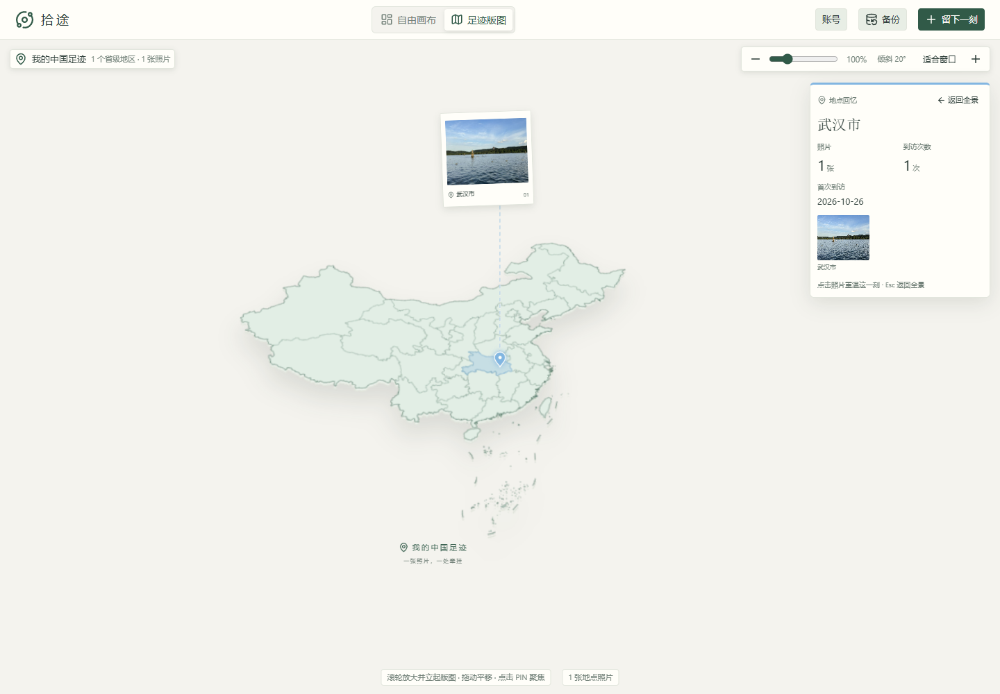
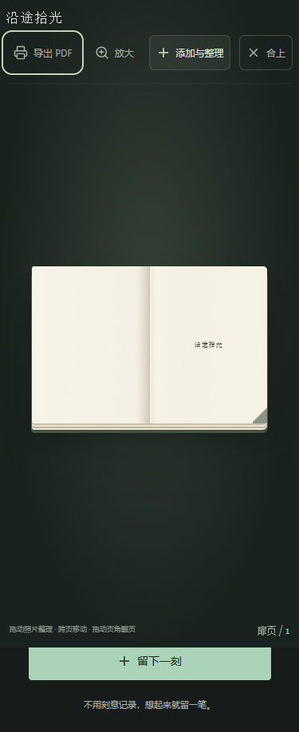

# 拾途 · 私人旅行手帐

用照片、文字与贴纸记录旅程，在自由画布、足迹版图和主题手札中整理回忆。支持桌面和手机、深浅主题，以及按账号隔离的私人内容。

## 功能

- **自由画布**：拖动、缩放、多选与批量编辑，照片、文字、贴纸和可嵌套折叠的色块共同排版，布局自动保存。
- **足迹版图**：使用本地中国行政区数据展示照片地点、到访统计与地点聚焦；支持城市名称、照片 GPS 和可选的高德地点搜索。
- **主题手札**：自定义封面、扉页、内页布局、书签与阅读进度；通过浏览器打印导出 PDF。
- **照片导入**：单次编辑最多 20 张，批量导入最多 500 张，分批保存；读取 JPG EXIF 日期与 GPS，支持逐张组件、滤镜和焦点。
- **备份还原**：导出当前账号的手帐 ZIP，包含展示照片、封面与布局；还原合并为新内容，重复导入会产生副本。
- **账号体系**：邮箱登录、验证、找回和修改密码；服务端会话、资源归属校验和私有图片读取。注册默认关闭。
- **示例与场景**：内置示例手帐；西湖相关照片可进入按需加载的专属 3D 场景。

当前是多账号初版，生产运行边界和升级步骤见 [运行与迁移说明](docs/operations.md)。

2026-10-31 开发检查点：画布大图库优化的桌面500张子集已验收，实验开关仍默认关闭；完整矩阵和发布验收未结束。[总体进度与暂停位置](docs/verification/2026-10-31-stage-checkpoint.md)。

## 界面预览

以下为实际生产构建在模拟 API 下的截图，仅使用仓库示例资料；不代表线上部署或真实用户数据。

| 足迹版图（桌面） | 手札阅读（手机） |
| --- | --- |
|  |  |

截图来自 `npm run test:smoke`；可以在本地启动后使用内置示例体验。当前没有承诺长期可用的公共演示站。

## 技术栈

React 19、Vite、Tailwind CSS、Three.js；Node.js 24+、Express、MySQL 8.4。MySQL 由 Docker Compose 提供；图片默认存储在本地 `uploads/`，由 API 鉴权读取。

## 本地启动

需要 Node.js 24+、npm 和已启动的 Docker（Windows 使用 Docker Desktop 的 Linux 容器）。以下命令使用 PowerShell 7。

```powershell
npm ci
Copy-Item .env.example .env
```

编辑 `.env`，设置 `MYSQL_PASSWORD` 和 `MYSQL_ROOT_PASSWORD`。已有 `.env` 时保留原配置并按示例补充字段。

```powershell
npm run db:up
```

**新空库**先迁移，再创建已由运维确认邮箱归属的账号：

```powershell
npm run db:migrate
$env:INITIAL_USER_PASSWORD = Read-Host '设置账号密码（12–128 字符）' -MaskInput
npm run db:create-user -- --email=you@example.com
Remove-Item Env:INITIAL_USER_PASSWORD
npm run dev
```

打开终端显示的前端地址，默认 [http://localhost:5173](http://localhost:5173)，用刚创建的账号登录。`APP_ORIGIN` 必须与实际浏览器来源一致。

**已有资料的数据库**先阅读 [历史数据迁移流程](docs/operations.md#历史数据迁移)，明确旧资料所属账号后再迁移。服务启动只检查迁移状态，不自动修改表结构。

## 配置

完整模板见 [.env.example](.env.example)。数据库密码、SMTP 凭据和高德 Key 仅供后端使用，禁止放入 `VITE_*` 变量。

| 配置 | 用途 |
| --- | --- |
| `MYSQL_HOST` / `MYSQL_PORT` / `MYSQL_DATABASE` | 默认 `127.0.0.1:3307`，数据库 `footprint_map` |
| `MYSQL_USER` / `MYSQL_PASSWORD` | API 的数据库凭据 |
| `MYSQL_ROOT_PASSWORD` | Compose 首次初始化数据库与本地隔离测试 |
| `APP_ORIGIN` | 浏览器来源，默认 `http://localhost:5173`，无尾部斜线 |
| `API_HOST` / `API_PORT` | API 默认监听 `127.0.0.1:3001` |
| `AMAP_WEB_SERVICE_KEY` | 可选，高德 **Web 服务** 类型 Key；未配置时仍可手动填写地点 |
| `AUTH_REGISTRATION_ENABLED` | 默认 `false`；启用前配置并验证 `SMTP_URL`、`MAIL_FROM` |
| `UPLOAD_DIRECTORY` | 可选，私有图片目录；默认 `uploads/`，迁移与运行必须一致 |
| `MIGRATION_MYSQL_USER` / `MIGRATION_MYSQL_PASSWORD` | 可选，独立迁移与建号凭据 |
| `MYSQL_SSL_CA` | 可选，跨主机 MySQL 的 TLS CA PEM |
| `TRUST_PROXY_HOPS` | 可选，按实际反向代理拓扑设置 |
| `TEST_MYSQL_ADMIN_USER` / `TEST_MYSQL_ADMIN_PASSWORD` | 隔离测试凭据，缺省使用 root / `MYSQL_ROOT_PASSWORD` |

高德请求由后端代理，Key 不下发到浏览器。照片展示文件经解码、旋转校正、缩放及去元数据处理，**不另外保存原图**；需要原图时请独立留存。地点组件仍可保存用户选择的 GPS 信息。

## 常用命令

| 命令 | 用途 |
| --- | --- |
| `npm run dev` | 同时运行 API 与 Vite，代理 `/api`、`/uploads` |
| `npm run dev:api` / `npm run dev:web` | 分别启动后端或前端 |
| `npm run build` | 生成前端 `dist/` |
| `npm start` | API 提供构建后的页面，默认 [http://127.0.0.1:3001](http://127.0.0.1:3001) |
| `npm run db:up` / `npm run db:down` | 启动 / 停止 MySQL，保留持久卷 |
| `npm run db:migrate` | 显式执行数据库迁移 |
| `npm run assets:gc -- --dry-run` | 预览超过 24 小时的未引用图片与待重试删除任务 |
| `npm run assets:gc` | 回收上述图片并释放容量；保留仍被照片或封面引用的文件 |
| `npm run maintenance -- --dry-run` | 预览过期会话、邮件凭据、限流记录和遗留文件清理 |
| `npm run maintenance` | 手动执行维护；正常服务每小时自动执行一次 |
| `npm run ops:check` | 检查受保护的运维状态，容量或错误告警时返回非零退出码 |
| `npm run backup:system -- --offline --out <新目录>` | 停写维护窗口创建完整恢复点 |
| `npm run backup:verify -- <目录>` / `npm run backup:drill -- <目录>` | 校验恢复点 / 在随机隔离数据库中演练恢复 |
| `npm run check:bundle` | 检查真实构建依赖图和首屏分包预算 |
| `npm run lint` | 静态检查 |
| `npm test` | 前端、模型和 API 边界单元测试 |
| `npm run test:security` | 身份 HTTP 测试及所有权、私有资源回归，使用数据库/邮件替身 |
| `npm run test:api` | 创建随机临时 MySQL 库和图片目录，执行真实接口集成测试后清理 |
| `npm run test:e2e` | 在独立临时 MySQL 库中，用真实 API 检查桌面/手机登录、上传、私有图片、手札、备份还原与退出 |
| `npm run test:smoke` | 使用模拟 API 检查桌面/手机深浅主题、版图和阅读器焦点 |
| `npm run test:image-resources` | 在原生浏览器中用合成 API 检查可选资源池的请求合并、解码、会话重置、源删除与清理，不连接个人数据库 |
| `npm run test:canvas-residency` | 合成500/2000张资料的原生浏览器驻留检查，覆盖桌面/平板、缓存开关、封面总预算、选择与概览入口 |
| `npm run test:canvas-ui` | 使用模拟 API 和真实浏览器检查桌面/触屏平板的拖动取消、框选、快捷键隔离、多指输入与布局提交 |
| `npm run test:layout-migration` | 在显式指定的隔离 MySQL 上验证布局版本迁移；需设置 `LAYOUT_TEST_MYSQL_PORT`、`LAYOUT_TEST_MYSQL_PASSWORD`，可选 `LAYOUT_TEST_MYSQL_USER`；只创建和清理随机测试库 |
| `npm run test:layout-lifecycle` | 使用同样的显式隔离 MySQL 配置，验证真实迁移、CLI 建号和重复执行；只创建和清理随机测试库 |

`test:api` 和 `test:e2e` 需要数据库建库权限，自动生成随机测试库与临时图片目录，结束后清理，不访问个人手帐数据库。浏览器测试在 Windows 使用 Edge，其他平台使用 Playwright Chromium（首次执行 `npx playwright install chromium`）。真实浏览器失败截图和追踪写入 `test-results/real-e2e/`，模拟检查截图写入 `test-results/ui-smoke/`，均不进入版本控制。

`test:api` 还包含完整系统恢复演练，覆盖双账号、旧表与手帐关系、日期/JSON/大整数及图片哈希。监控配置见 [监控与维护](docs/monitoring.md)，停写条件和恢复点权限见 [恢复演练](docs/recovery.md)。

CI 见 [.github/workflows/ci.yml](.github/workflows/ci.yml)，在临时 MySQL 服务上执行静态检查、单元测试、安全测试、真实 API 测试、依赖审计和浏览器冒烟测试。

真实浏览器用例位于 `tests/e2e-real/`，由专用配置收集。`server/` 的旧单用户测试和 `tests/e2e/` 的旧场景尚未统一更新账号夹具，不会混入当前验证入口；不要对个人数据库直接运行旧测试。

## 构建运行与手机访问

```powershell
npm run build
npm start
```

本地构建运行时，将 `APP_ORIGIN` 改为 `http://127.0.0.1:3001`。手机与电脑连接同一局域网时，设置 `API_HOST=0.0.0.0`，把 `APP_ORIGIN` 改为 `http://电脑局域网IP:3001`，重启 API 后从手机访问该地址。浏览器定位需要安全上下文，局域网 HTTP 下可手工填写地点。

生产环境使用 HTTPS 和 `NODE_ENV=production`，设置准确的来源、代理和数据库权限，详见 [运行说明](docs/operations.md)。

升级此版本需先停服务，备份后运行 `npm run db:migrate` 创建共享限流表，再重新构建并启动。所有 API 实例必须连接同一 MySQL 主库、共用图片目录，并使用相同的 `RESTORE_CONCURRENCY`（默认 2）；不需要 Redis。图片校验和还原在独立工作线程处理，每个账号同时最多一个还原。当前 HTTP 请求会等待任务结果，任务不提供持久化排队或断点续传。

画布首页按需加载版图、阅读器、编辑器与备份窗口；地图地理数据不再随首页下载。当前手帐入口分包约 61kB（gzip 21kB），可选地图包约 802kB，首次打开版图时仍需加载。

## 数据与备份

- 手帐保存在 MySQL `journal_*` 表，账号、会话和图片归属由服务端维护。
- 数据库位于 Compose 的 `mysql_data` 卷，图片位于 `uploads/` 或 `UPLOAD_DIRECTORY`。
- 界面下载单个 ZIP，归档与解压总量上限 **576MiB**，覆盖 512MiB 账号图片容量并预留清单空间；清单最多 16MiB，单图最多 10MiB，不支持 ZIP64。
- 浏览器直接下载，服务端逐文件读取与还原，不把整包加载进内存；兼容旧版 ZIP。还原仍受账号剩余容量限制，失败时回滚并清理新文件。
- 更换封面、删除手札或照片后自动回收没有任何引用的图片；长时间未关联的上传及失败删除任务通过 `assets:gc` 维护。
- 完整部署备份需同时保存数据库和图片目录，并验证恢复。`docker compose down -v` 会删除数据库卷。
- 旧打卡通过显式迁移导入手帐；旧攻略、打卡、点赞等 API 返回 410，原始资料仍保留。

## 目录

```text
src/auth/         账号界面与会话状态
src/journal/      自由画布、手札、版图与导入
src/data/         离线地理数据与来源说明
src/lib/          API 客户端
server/           API、权限、图片、备份与数据库迁移
shared/           前后端共用逻辑
scripts/          迁移、建号、数据准备与验证入口
tests/            单元测试与浏览器场景
public/           示例照片、封面与 3D 场景资源
docs/             当前运行与迁移文档
```

## 数据和素材来源

- 景点数据：[China-Travel-Map](https://github.com/marksui/China-Travel-Map)，本地文件 `server/landmarks.sql`。
- 地理边界与城市中心：[地理数据来源说明](src/data/china-boundary-attribution.md)。
- 示例照片：[来源声明](public/journal-demo/ATTRIBUTION.md)。
- 手札封面：[来源声明](public/notebook-covers/Attribution.md)。
- 西湖场景：[来源声明](public/scenes/ATTRIBUTION.md)。

## 开发、发布与参与

- [架构与代码入口](docs/architecture.md) · [贡献指南](CONTRIBUTING.md)
- [发布检查与验收记录模板](docs/release-checklist.md) · [变更记录](CHANGELOG.md)
- [M0 验证记录](docs/verification/2026-10-29-m0.md) · [长期开发计划](docs/superpowers/plans/2026-10-29-long-term-development.md)
- [安全报告流程](SECURITY.md)（GitHub 私密报告已启用）

目前为早期多账号版本，稳定发布、生产部署和完整验收状态以对应记录为准。生产安装暂按 [运行说明](docs/operations.md)、[监控](docs/monitoring.md) 和 [恢复](docs/recovery.md) 手动完成；应用镜像和一体化生产部署属于后续阶段。

项目自有代码采用 [MIT](LICENSE)。第三方依赖、照片及地理数据保留各自许可；已核对的声明与公开分发前待确认事项见 [第三方说明](docs/third-party-notices.md)。
