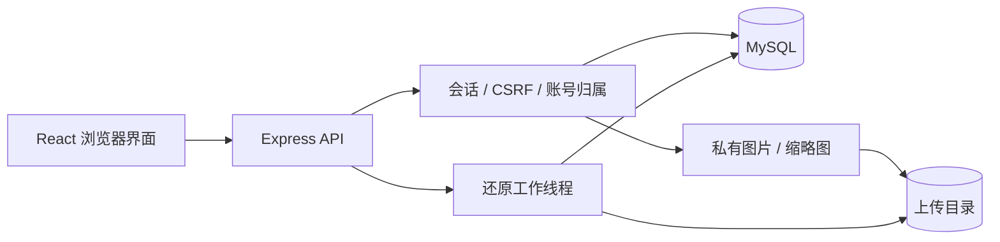

# 拾途架构与开发入口

## 运行结构

开发时 Vite 代理 `/api` 和 `/uploads`；构建后 `server/app.js` 提供 `dist/`。`server/index.js` 检查迁移标记、启动 API、维护任务，并处理进程退出。应用启动不自动执行数据库迁移。

## 内容模型

`journal_trips` 表示旅行；`journal_entries` 记录日期和内容，`journal_photos` 属于条目。文字/贴纸等画布内容见 `journal_marks`。色块分组和成员关系见 `journal_canvas_groups`、`journal_canvas_group_photos`、`journal_canvas_group_children`，确切约束以 schema 和迁移为准。

`journal_notebooks`、`journal_notebook_pages` 及 `journal_notebook_photo_items`、`journal_notebook_mark_items`、`journal_notebook_entry_items` 保存手札、页面和各类内容引用。画布排布与手札内部编排有不同位置语义，改动前应阅读 `src/journal/notebooks.js` 和 `server/notebooks.js`，不能将内容移动简单等同为复制文件。

账号、会话、邮件验证/重置凭据、资产登记和共享限流由 `server/auth-schema.sql` 及迁移维护。`assets` 将存储键绑定到所有者；删除照片还需检查其他照片/封面引用。

历史 `landmarks` 等表仍用于兼容和部分读取；旧共享写接口已停用，不得绕过私人手帐 API 重新启用。

## 请求与安全边界

- `src/lib/api.js` 处理前端请求；`useJournal.js` 协调加载、修改及界面状态，并限制旧会话请求。
- `server/auth.js` 处理身份、会话、来源与 CSRF。`app.js` 安装路由和限流。
- `server/journal.js`、`notebooks.js` 在业务查询和写入中实施所有权约束。只检查路由登录不足以保证对象归属。
- `/uploads` 经 `requireAuth` 和私有图片处理器读取；不能由 Nginx/CDN 直接公开磁盘目录。
- `thumbnails.js` 在鉴权后读取或生成派生图；缓存是可重建文件，不进入系统备份，不替代资产归属校验。
- `asset-lifecycle.js` 协调引用检查、登记状态、文件删除及重试；不得绕过它直接删除仍被引用的文件。

## 界面与画布

`JournalPage.jsx` 组织主要视图，`JourneyCanvas.jsx` 管理相机、输入和选择；`model.js` 提供布局/几何与模型函数，`canvasCollision.js` 和 `groupExpansion.js` 负责避让及展开计算。`CanvasItem.jsx`、`JournalImage.jsx` 渲染内容；`PlaceAtlas.jsx` 是足迹视图；`NotebookReader.jsx`、`NotebookPrint.jsx` 负责阅读和打印。

现有视图通过服务端内容关联，不是多个独立数据副本。大功能按需加载，`scripts/check-bundle.mjs` 检查画布首次依赖图。

## 备份、迁移与测试

个人备份由 `backup.js`、ZIP 模块和还原工作线程处理，导入生成新 ID；全系统恢复点由 `system-backup.js` 及演练脚本处理。两者恢复范围不同，参见 [恢复说明](recovery.md)。

迁移入口为 `scripts/migrate-database.js`，历史归属迁移见 `server/migrate-ownership.js`。测试入口、真实数据库隔离方式和验收记录见 [发布检查](release-checklist.md)。

当前边界：单一 MySQL 主库及共享上传目录；还原无持久化任务队列；CSP 仍为报告模式。本文描述现状，未来方向见 [长期计划](superpowers/plans/2026-10-29-long-term-development.md)。
