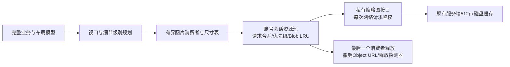

# 数百张图片画布：会话资源缓存与驻留控制设计

日期：2026-10-31。状态：P0基线完成，P1调度核心与P2可选会话/React组件已实现，P3/P4尚未实施；详见[并行验收](../../verification/2026-10-31-image-resources-parallel.md)。用户已确认目标为500张照片流畅编辑、2000张压力档，优先桌面并兼顾平板；资源预算已按P0冻结为首轮验收目标，概览表现仍需样例审阅；预算不是已达到的结果。

## 1. 问题与现状

| 路径 | 已有实现 | 不能据此作出的结论 |
| --- | --- | --- |
| server/thumbnails.js | 512px WebP、源文件指纹磁盘缓存、同源任务去重、1个生成任务、最多64个pending；每次请求先校验所有权 | 不等于浏览器不再重复请求或解码 |
| JournalImage.jsx | 私有小图使用?thumbnail=1，lazy/async，最多2次缩略图重试，不自动回退大图 | 没有统一请求队列、会话内资源复用或字节预算 |
| JourneyCanvas.jsx | 视口外筛选，中心判定加600px屏幕余量；相机和布局分离 | 低倍概览可能仍让数百张卡片同时进入候选范围 |
| imageSizes/model | 单个画布按url记录尺寸，每次尺寸状态变化可能重算全模型 | 尺寸信息未统一复用，不能把网络优化当作CPU优化 |
| api.js/AccountGate | API会话代际、abort、退出/401清理；同账号重新确认也会更换API代际 | 新媒体fetch不在/api路径，不能直接套apiFetch('/uploads/...') |
| 私有资源策略 | /uploads和/api保持private, no-store；CSP Report-Only已包含blob: | 不能为了速度改成public/CDN长期缓存，Report-Only也不等于已执行CSP |

已完成100/500/2000张共60例和600.58秒压力测试，结果见[P0正式报告](../../verification/2026-10-31-canvas-image-cache-p0.md)。本轮591项测试验证测量工具和既有回归，不证明尚未实现的缓存达标。

## 2. 采用的层次

保留既有服务端派生图磁盘缓存，新增位于画布图片消费者和私有缩略图接口之间的**当前账号会话内资源池**。资源池负责请求合并、压缩Blob复用、有限并发和引用计数；画布驻留规划负责限制真正挂载和解码的图片数量；轻量尺寸表与批量提交负责减少重复布局计算。

缓存只作用于显示资源，不缓存可编辑布局或绕过保存协调器。500张对象完整保留在业务/碰撞/选择模型中，不把“没有挂载图片”误当成对象不存在。暂不引入Redis、CDN、Service Worker、Cache API、IndexedDB、WebGL或新的画布SDK；不缓存原图，不改变打印/显式大图路径。需要离线持久化时另立项。

## 3. 资源状态与接口

- scope为`{ownerId, apiEpoch, mediaEpoch}`。key为scope+规范化私有资源路径+固定thumbnail512-v1。不能用layout_version作图片版本，否则每次拖动都会清空图片缓存。
- 仅接管当前画布明确提供的同源/uploads文件及固定thumbnail变体；公共演示、data:、编辑器blob:与fullSize维持原路径，资源池不撤销其他模块创建的URL。
- `createImageResourceCache({scope, limits, fetchMedia, clock})`返回`acquire({src, priority, role})`、`invalidateSources(urls)`、`dispose()`、`getStats()`。role必须明确为display或prefetch。acquire返回`{getSnapshot, subscribe, release}`租约；状态是deferred/queued/loading/ready/error/closed。display的ready给出本scope的objectUrl、width、height；prefetch只预取压缩Blob，ready不提供可渲染URL，尺寸未知时为空，不主动创建Image/解码。
- 每个实际img拥有一个display租约，不允许一个租约供多个DOM图片使用；display租约取得时就预留一个图片名额，所以activeDisplayLeases是实际img数的保守上界，实际DOM图片数由浏览器另测。prefetch租约不占显示名额，但计入条目/Blob/队列/网络预算；相同key的两种租约仍合并fetch，display需要时才排解码。快照可按租约role反映就绪阶段，不能把Blob已取到当成display已解码。
- 同key只有一个fetch和共享结果；不同消费者分别持有租约，release幂等，不因一个组件卸载取消其他消费者。最后一个租约离开时取消无需求任务；已完成压缩Blob可进入有界LRU，但不长期保留额外Image探测器。
- Object URL只在解码/实际消费者需要时创建。最后一个显示/解码消费者脱离后撤销URL，清除探测器src/引用；温缓存保留压缩Blob，返回时可免网络重新创建URL，但不能承诺浏览器免二次解码。
- 过期/取消任务即使晚到也先检查scope和任务代际，不能发布ready；已创建的URL必须撤销。单key重新加载使用新任务代际，旧回执不能覆盖新数据。
- 用HTMLImageElement.decode控制应用主动安排的探测工作，异常走统一错误状态；decode并不承诺浏览器为后续多个img共享已解码位图。消费者实际img、探测器、GPU/浏览器内部资源分别统计，不能只统计Blob.size。

## 4. 初始预算与退化规则

以下为P0后冻结的首轮实现/验收预算，不是设备总内存保证。MiB=1024²字节。

| 指标 | 桌面profile | 平板/保守profile |
| --- | ---: | ---: |
| Blob+在途响应预留预算 | 24MiB | 12MiB |
| 压缩资源LRU最多条目 | 512 | 256 |
| 应用估算解码工作集预算 | 64MiB | 32MiB |
| 全画布同时挂载的实际img（含分组封面） | 48 | 24 |
| 同时fetch任务 | 4 | 2 |
| 同时主动decode探测器 | 2 | 1 |
| 排队的唯一资源 | 64 | 32 |
| 低成本详细卡片DOM上限 | 120 | 60 |
| 单缩略图响应上限/超时 | 2MiB/10秒 | 2MiB/10秒 |
| 会话验证/资源硬过期上限 | 60秒/60秒 | 60秒/60秒 |

512×512×4约为1MiB只是RGBA量级估算；500张全部保留该尺寸位图约500MiB，不是当前实测占用。每个实际img消费者都计入解码估算，不能仅按唯一URL计费；同时存在的探测器也计费。原图预览、打印、DOM/JS、GPU和浏览器内部缓存不在此应用估算内，必须另测总进程/页面内存。

对未知响应先按单项2MiB预留，读取body时逐块计数并在超限时中止；Content-Length只作提前拒绝提示，不作为可信上界。预算包含在途任务，不允许24MiB已驻留再额外叠加4个大响应。先淘汰无引用LRU；活跃租约不强行撤销导致闪烁，不能容纳时延后新请求、显示占位。新旧资源替换的瞬时双份也必须预留；无余量先释放旧资源再请求。

资源优先级为正在交互且已驻留 > 视口内 > 小范围滚动方向预取；选中全部500项不将500张图片全部pin住。队列满时撤掉低优先级预取，视口需求进入deferred并等待调度通知，不能给每个占位创建独立重试定时器。503/断网共享每key的2次800/1600ms退避，取消不重试，401/404不重试，不回退大图。被取消的任务释放槽位，但不假定已经撤回服务端缩略图生成。

profile首次由粗指针或视口宽度≤1024px选保守档，否则桌面档，不据此推断真实设备内存；测试可显式注入profile。缩小窗口时先等待活动手势结束、削减租约到新上限，再原子切换profile；收敛前仍按旧profile报告，不能一边声称24上限一边保留48个活跃img。账号失效/删除优先于交互pin，资源到期或隐私清理不受“预算压力不强制驱逐活跃租约”的规则阻挡。

## 5. 视口与尺寸缓存

1. 将可见/预取范围统一投影到世界坐标，按旋转边界相交而非只看中心点筛选。先保留线性扫描，空间索引须由P0的CPU证据支持，不先引入新库。
2. 同帧相机更新最多提交一次驻留规划；拖动中的目标和当前已挂载组成员保持稳定，不因视口排名变化卸载焦点/捕获节点。组中500个对象不需要500个DOM节点，组移动仍对完整模型原子保存。
3. 照片投影边长过小或候选超预算时进入低细节概览：优先复用旅程/色块封面，散落照片按固定屏幕网格聚合计数/占位，不为每个小点创建完整照片卡和img。分配img名额优先交互目标与视口中心，保持稳定排序/滞后边界，避免平移时来回换图。具体概览表现需在实现前用500张样例审阅。
4. 未取得img名额的对象仍可通过模型框选、全选与键盘微调；F定位/缩放到局部后升级细节。新增聚合节点不得伪装成可直接编辑的照片，必须给出进入局部查看的明确入口。当前焦点节点需要保留；500张全选只保留现有焦点节点，不突破img预算。
5. 尺寸表按scope+源路径+媒体代际保存轻量宽高，最多4096项，独立于Blob LRU。每帧批量通知尺寸变化、相同值不通知，减少每张onLoad都触发全模型重算。仍保留reserveUndecodedPhotos的碰撞保留规则，未知尺寸使用固定占位，不为获取尺寸提前下载全部图片，不因缓存进出移动用户布局。
6. 首期仅接入JourneyCanvas及其分组封面；NotebookReader、PhotoViewer、打印与移动照片流不自动并入资源池。后续复用必须有独立预算和功能检查，不能把本批48张上限宣称为整个应用的img上限。

## 6. 会话、失效与私有资源

- HTTP仍是private,no-store；新增的是明确受控的应用内显示资源短暂持有策略，不启用HTTP/共享缓存存储私有响应。不能把no-store当作允许应用任意保留资源的依据；资源池的会话清理与期限必须另行验收。fetch显式同源credentials与cache:no-store，所有网络请求仍由服务器校验所有权。不得修改为public或放宽上传目录访问。
- `privateMedia.js`单独访问/uploads，不拼到/api前缀下。复用captureApiSession，在请求前、响应头后、body读取后、decode发布前检查代际；拥有自己的AbortController注册表。401沿用clearApiSession和shitu-session-expired路径，校验MIME/大小并拒绝未知来源。
- api.js增加只读epoch快照和reset订阅。clearApiSession、退出、账号切换、401以及同账号重新accept都会同步使旧资源池关闭。只替换资源scope，不以epoch给整个JournalPage加key而重挂载，防止同账号会话确认丢失尚未保存的布局。
- 页面前台恢复先做只读session校验；活动期最多60秒一次共享校验，超出有效期不得新发放温缓存租约，校验失败/离线到期时显示图片占位但保留布局与重试状态。不要为周期校验调用AccountGate.accept而每次重置API代际。
- 本地删除、替换、导入/恢复后的新快照对媒体成员关系作diff并失效相关URL；恢复可全量递增mediaEpoch，不把归档缓存带回。文字/位置/旋转编辑不失效图片像素。正常新资源使用现有不同文件名；同路径被外部替换或其他页面删除只能在下一次GET/硬过期/会话检查发现，不能承诺即时远端撤销。
- 资源硬TTL从网络完成时计算，命中不续期；资源池使用一个最早到期计时器批量检查，包括仍被引用的活跃项，不能只在下一次acquire才发现过期。到期后重新经过服务器，局部更新不绕过预算。退出/关闭释放全部应用持有引用，不承诺浏览器、操作系统或GPU立即归零，也不把no-store当作已下载像素的远程抹除机制。

## 7. 验收与不变量

- 100/500/2000张均使用不同私有URL、合成横竖照片与文字、嵌套/折叠组，覆盖稀疏平移与所有对象进入视口的低倍概览；不能复用一张url500次冒充资源规模。
- 分开测服务端派生图冷/热、浏览器新会话、应用会话池冷/热。比较三组：旧路径、仅驻留控制、驻留+资源池；回访路径在预算及TTL内，后两组相同驻留策略下，关缓存存在重复请求时，预热后重复媒体请求减少80%为资源池目标（零重复基线记N/A），不能把LOD少显示图片的收益全部记为缓存命中。超预算/到期场景另报，不从命中率统计中偷偷剔除。
- 500档预热平移的rAF帧间隔p95目标≤32ms，并另报长任务、React/model耗时；rAF不是渲染/GPU帧耗时的完整替代。2000压力档连续操作10分钟无崩溃、能选中并完成保存/撤销/冲突恢复。
- 编码预算、任务/条目/实际img上限是可自动断言的硬不变量。实际解码/页面/进程内存只能测量，不能用JS heap或缓存计数冒充总内存；measureUserAgentSpecificMemory需要满足安全上下文与跨源隔离，不能为了测量偷偷改部署隔离策略。
- 同一环境至少5次独立运行，报告原始样本、median与最差值；桌面1440×1000与触屏平板1024×844、深浅主题，记录机器/浏览器/构建/网络；物理平板另验收。首次可操作从navigationStart到布局已就绪且工具可用，另报首张图片与首视口资源完成时间、错误数，不能靠把所有图片变成失败占位提前结束。参考机500档首次可操作≤600ms、首视口95%图片就绪≤1500ms；预热p95相对旧路径的退化容忍界为max(旧值20%,2ms)。500档自有浏览器工作集汇总代理桌面≤650MiB、保守档≤640MiB，2000压力档≤1100MiB；这些是待达成目标，不是页面/GPU内存。真实设备预算另行实测。
- 所有权/退出/401/同账号重新确认、旧body/decode晚回执、共享消费者释放、503重试、URL撤销、源删除/恢复、离线到期、F/拖动/500项原子保存均有单元与真实浏览器/隔离API检查。

## 8. 选择、回退与资料

先P0测量，再实现资源池与驻留控制；只有缓存+驻留的验收同时通过才启用新路径。构建开关默认关闭，失败可回退现有JournalImage及既有视口路径，不改URL、备份或布局格式；不得回退为公开访问或缩略图失败下载原图。初期不加多尺寸派生图：若512px在高DPR细节下确有不足，再单独设计固定受控变体与版本预算。

技术依据（2026-10-31查阅）：[Blob URL生命周期](https://developer.mozilla.org/en-US/docs/Web/URI/Reference/Schemes/blob)、[revokeObjectURL](https://developer.mozilla.org/en-US/docs/Web/API/URL/revokeObjectURL_static)、[HTMLImageElement.decode](https://developer.mozilla.org/en-US/docs/Web/API/HTMLImageElement/decode)、[Cache-Control](https://developer.mozilla.org/en-US/docs/Web/HTTP/Reference/Headers/Cache-Control)、[内存测量API限制](https://developer.mozilla.org/en-US/docs/Web/API/Performance/measureUserAgentSpecificMemory)。这些资料支持API与缓存语义，不证明本项目性能达标。

## 9. 本轮设计审查

独立只读builder/design check未发现影响实施规划的关键缺口，确认预算、失效、会话重确认、驻留与指标边界可执行。审查提出预取租约与真实图片消费者需要明确区分；已补充role及display名额的保守计数，预取不创建Object URL或主动解码。设计轮未运行基准。后续P0已完成测量及591项回归；独立工具审查指出的就绪计时偏差已通过导航前观察器修正并回归，正式报告保留实测脚本哈希。缓存尚未实现。
